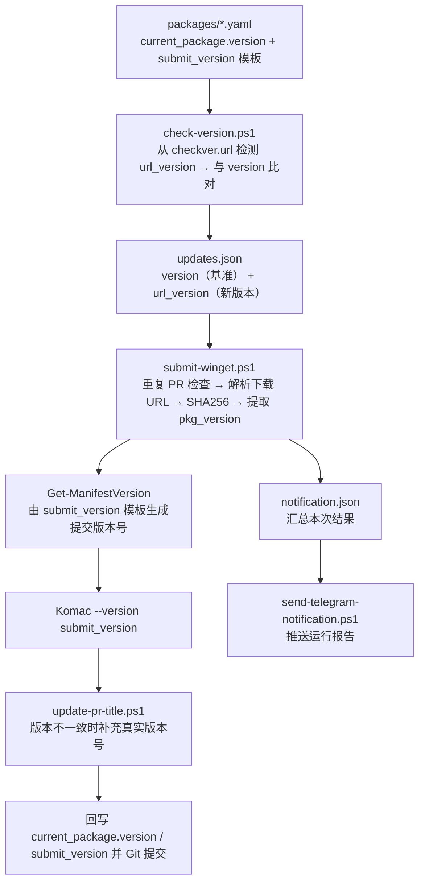

<div align="center">
  

  <p><em>自动追踪任意网站的软件新版本，并向 <a href="https://github.com/microsoft/winget-pkgs">winget-pkgs</a> 提交更新 PR。</em></p>

  <a href="https://github.com/leic4u/WinGet-Tracker/actions/workflows/update.yml"></a>
  <a href="https://github.com/leic4u/WinGet-Tracker/blob/main/LICENSE"></a>
  <a href="https://github.com/leic4u/WinGet-Tracker/stargazers"></a>
  <a href="https://github.com/leic4u/WinGet-Tracker/pulls"></a>
  <br />
  <a href="https://learn.microsoft.com/powershell/"></a>
  <a href="https://github.com/features/actions"></a>
  <a href="https://learn.microsoft.com/windows/package-manager/"></a>
</div>

---

[功能特性](#功能特性) · [快速开始](#快速开始) · [项目结构](#项目结构) · [配置文件](#配置文件) · [脚本说明](#脚本说明) · [工作流程](#工作流程) · [Telegram 通知](#telegram-通知) · [许可证](#许可证)

## 简介

WinGet Tracker 是一套运行在 GitHub Actions 上的 PowerShell 自动化流水线。每个软件包对应 `packages/` 下的一份 YAML 规则：定时从官方源检查新版本，解析并下载安装包、计算 SHA256，再借助 [Komac](https://github.com/russellbanks/Komac) 向 [microsoft/winget-pkgs](https://github.com/microsoft/winget-pkgs) 提交版本更新 PR。检测、提交与异常都会汇总成一份报告，通过 Telegram Bot 推送。

## 功能特性

| 能力 | 说明 |
| --- | --- |
| 版本检测 | 按 cron 定时巡检，支持 GitHub Releases、JSON API、网页正则三种模式 |
| 下载解析 | URL 模板变量替换、jsonpath 提取、GitHub Release assets 按文件名匹配 |
| 完整性校验 | 下载安装包并计算 SHA256（带重试），从 EXE / MSI / MSIX 提取内置版本号 |
| 自动提交 | 重复 PR 检查 → Komac 提交 PR → 必要时补充 PR 标题 → 回写 YAML 配置 → 自动 Git 提交 |
| 版本防误报 | 真实版本号与提交版本号分离（`version` / `submit_version`），避免带构建号的版本每次被误判为更新 |
| 结果通知 | 运行结束后推送 Telegram 富文本报告，包含更新、PR、错误与跳过项，并支持格式降级 |
| 仓库维护 | 自动同步 fork 上游、清理已合并 PR 分支、完整日志便于追踪调试 |

## 快速开始

### 环境要求

| 依赖 | 说明 |
| --- | --- |
| PowerShell 7+ | 全部脚本的运行环境 |
| [powershell-yaml](https://github.com/cloudbase/powershell-yaml) | 解析 YAML 配置 |
| [Komac](https://github.com/russellbanks/Komac) | 生成 manifest 并向 winget-pkgs 提交 PR |
| [GitHub CLI](https://cli.github.com/) | 搜索 PR、更新 PR 标题 |

```powershell
Install-Module powershell-yaml -Scope CurrentUser -Force
winget install RussellBanks.Komac --source winget
winget install GitHub.cli --source winget
```

### 环境变量

| 变量 | 必需 | 说明 |
| --- | --- | --- |
| `WINGET_TOKEN` | 是 | GitHub Personal Access Token，需要 `public_repo` 权限，且对 fork 的 winget-pkgs 有写权限 |
| `TG_BOT` | 否 | Telegram Bot Token，未配置时自动跳过通知 |
| `TG_USER` | 否 | 接收消息的 Telegram Chat ID |

### 本地运行

```powershell
$env:WINGET_TOKEN = "your_github_personal_access_token"

# 1. 遍历 packages/ 检查远程版本，发现更新时写入 updates.json
.\scripts\check-version.ps1

# 2. 读取 updates.json，校验哈希、提取版本、提交 PR 并回写配置
.\scripts\submit-winget.ps1
```

`check-version.ps1` 按 `checkver` 规则并行检查所有包；`submit-winget.ps1` 负责重复 PR 检查、下载与哈希、内置版本提取、Komac 提交、必要时补充 PR 标题、回写 YAML 的 `version` / `submit_version` 并 Git 提交，最后把结果写入 `notification.json`。

### GitHub Actions

Fork 本仓库后，在 Actions 中手动执行一次 `WinGet Tracker` 工作流，之后即会按计划自动运行。

- **触发方式**：cron（`37 4,10,16,22 * * *`，每天四次）、`workflow_dispatch` 手动触发、以及供 cron-job.org 调用的 `repository_dispatch`
- **运行环境**：`windows-latest`，工作流内的依赖安装、同步、检查、提交、清理、通知全部自动完成
- **Secrets**：`WINGET_TOKEN`（必需）、`TG_BOT` / `TG_USER`（可选）
- 工作流开始时会自动把 fork 的 winget-pkgs 主分支同步到上游 `microsoft/winget-pkgs`（见 `sync-winget-fork.ps1`），一般无需手动同步
- 通知步骤使用 `if: always()`，无论前序步骤是否成功，只要检测到更新就会推送报告

## 项目结构

```text
WinGet-Tracker/
├── assets/                 # 项目图标与图片资源
├── .github/workflows/      # GitHub Actions 工作流
├── packages/               # 每个软件包一份 YAML 规则
├── deprecated/             # 已下线的包配置
├── scripts/                # PowerShell 脚本
├── logs/                   # 运行日志（已忽略版本控制）
└── README.md
```

## 配置文件

每个软件包对应 `packages/` 下的一份 YAML 文件。

### 版本检查模式

```yaml
# 1. GitHub Releases：自动调用 GitHub API 获取最新 release
checkver:
  url: https://github.com/owner/repo

# 2. 网页正则：从 HTML 中提取版本号
checkver:
  url: https://example.com/download
  regex: Version ([\d.]+)

# 3. JSON API：支持自定义请求方法、请求头、请求体与 jsonpath
checkver:
  url: https://api.example.com/v1/version
  method: GET
  jsonpath: data.list.app_version
  exclude_pattern: "99"  # 可选，排除匹配的版本
```

### 四个版本字段

| 字段 / 变量 | 含义 | 出现位置 |
| --- | --- | --- |
| `version` | 当前已经记录的真实版本号，是版本比对的基准；在模板中等价于 `url_version` | `current_package.version`、`updates.json.version`、模板简写 `$version` |
| `url_version` | checkver 从 `checkver.url` 检测到的新真实版本号 | `updates.json.url_version`、模板变量 `$url_version` |
| `pkg_version` | 从安装包（EXE / MSI / MSIX）提取的内置版本号 | 模板变量 `$pkg_version`（提交阶段产生，不落盘） |
| `submit_version` | 提交到 winget-pkgs 的 manifest 版本号 | `current_package.submit_version`（结果）、`autoupdate.submit_version`（模板） |

判定流程：`current_package.version` 与检测出的 `url_version` 比对 → 有更新则解析下载、提取 `pkg_version` → 由 `autoupdate.submit_version` 模板（可用 `url_*` / `pkg_*` 变量）生成 `submit_version` 并提交。

### 版本号变量

所有变量名都支持**蛇形、驼峰、全小写**三种写法（例如 `$url_version` / `$urlVersion` / `$urlversion`）；配置字段键名同样支持蛇形与驼峰（`submit_version` / `submitVersion`）。

| 变量（蛇形 / 驼峰） | 等价简写 | 取值 |
| --- | --- | --- |
| `$url_version` / `$urlVersion` | `$version` | 检测到的真实版本号 |
| `$url_major` / `$urlMajor` | `$major` | 主版本号 |
| `$url_minor` / `$urlMinor` | `$minor` | 次版本号 |
| `$url_patch` / `$urlPatch` | `$patch` | 修订号 |
| `$url_build` / `$urlBuild` | `$build` | 构建号 |
| `$pkg_version` / `$pkgVersion` | — | 安装包内置版本号 |
| `$pkg_major` / `$pkgMajor` | — | 内置版本的主版本号 |
| `$pkg_minor` / `$pkgMinor` | — | 内置版本的次版本号 |
| `$pkg_patch` / `$pkgPatch` | — | 内置版本的修订号 |
| `$pkg_build` / `$pkgBuild` | — | 内置版本的构建号 |

`url_*` 系列与简写可用于下载 URL 模板和提交版本模板；`pkg_*` 系列只在 `autoupdate.submit_version` 模板里可用，因为安装包要下载后才能提取版本。

> 模板变量写错时不会静默通过：下载 URL 中残留的 `$变量` 会跳过该 URL 并告警，`submit_version` 模板中残留的 `$变量` 会直接阻止提交。

### 完整示例

```yaml
id: Publisher.AppName
current_package:
  version: "1.0.0"                 # 真实版本号（也可写 url_version），作为比对基准
  # submit_version: "1.0"         # 可选，见下方「真实版本号与提交版本号」
  architecture:
    x64:
      url: https://example.com/app-1.0.0-x64.exe
      hash: "SHA256_HASH"
checkver:
  url: https://example.com/releases
  regex: Version ([\d.]+)
autoupdate:
  submit_version: $pkg_major.$pkg_minor.$pkg_patch  # 可选，生成提交版本号的模板
  architecture:
    # 方式 1：URL 模板（纯字符串，支持 $url_version / $version 等变量替换）
    x64: https://example.com/app-$url_version-x64.exe
    # 方式 2：jsonpath，从 API JSON 中提取下载 URL
    # x86:
    #   jsonpath: data.list.url
    # 方式 3：match_url，从 GitHub Release assets 按文件名匹配
    # arm64:
    #   match_url: win-arm64
```

> **注意**：`match_url` 依赖 GitHub API 返回的 assets 数据，因此 `checkver.url` 必须是 GitHub 仓库地址（`https://github.com/owner/repo`）。

### 字段说明

| 字段 | 说明 |
| --- | --- |
| `id` | Winget 包标识符，格式 `Publisher.AppName` |
| `current_package.version` / `current_package.url_version` | 当前已记录的真实版本号（两种键名等价，也支持驼峰 `urlVersion`），与 checkver 检测出的 `url_version` 比对 |
| `current_package.submit_version` | 可选，实际提交到 winget-pkgs 的版本号；与 `version` 一致时省略 |
| `current_package.architecture` | 支持的架构及下载信息，随更新自动回写 |
| `checkver.url` | 版本检查目标 URL（GitHub / API / Web） |
| `checkver.regex` | 从页面提取版本的正则表达式 |
| `checkver.method` | [API] HTTP 方法（GET / POST / PUT，默认 GET） |
| `checkver.headers` / `checkver.body` | [API] 自定义请求头 / POST-PUT 请求体 |
| `checkver.jsonpath` | [API] 从 JSON 响应提取版本的路径，支持遍历数组 |
| `checkver.exclude_pattern` | [API] 可选，排除匹配的版本 |
| `autoupdate.submit_version` | 可选，生成提交版本号的模板表达式，可用 `url_*` / `pkg_*` 变量；键名支持蛇形 / 驼峰，旧字段 `version_format` 仍兼容读取 |
| `autoupdate.architecture.[x86/x64/arm64]` | 下载 URL 模板 |
| `autoupdate.architecture.[...].jsonpath` | [API] 可选，从 checkver 数据提取下载 URL |
| `autoupdate.architecture.[...].match_url` | [GitHub] 可选，按文件名正则匹配 Release assets |

### 真实版本号与提交版本号

部分软件的官方版本号带有构建号，而 winget-pkgs 的 manifest 只使用前三段。例如 Readdle.Spark 的 appcast 返回 `3.32.4.141552`，`autoupdate.submit_version` 模板把它格式化为 `3.32.4` 后提交。此时两个字段各司其职：

```yaml
current_package:
  version: "3.32.4.141552"   # 真实版本号（上次检测到的 url_version），供下次比对
  submit_version: "3.32.4"   # 提交到 winget-pkgs 的版本号
```

- `version` 恒由 `submit-winget.ps1` 写入 checkver 检测到的真实版本号（`url_version`）。若改写成提交版本号，`3.32.4.141552` 会被判定为高于 `3.32.4`，导致每次检查都误报更新。
- `submit_version` 是可选字段，仅当提交版本号与真实版本号不一致时写入；两者一致时脚本会自动省略该字段。
- 两个版本号不一致时，`submit-winget.ps1` 会在 komac 提交 PR 成功后，把真实版本号补到 PR 标题末尾，形如 `New version: Readdle.Spark version 3.32.4 (3.32.4.141552)`，便于审核者对照官方版本。

> **注意**：`autoupdate.submit_version` 是**模板表达式**（如 `$pkgMajor.$pkgMinor.$pkgPatch`），`current_package.submit_version` 是上一次**实际提交的版本号结果**。两者同名但分属不同层级，前者决定后者如何生成。

## 脚本说明

| 脚本 | 类别 | 功能 |
| --- | --- | --- |
| `check-version.ps1` | 主流程 | 检查所有包的新版本，并行处理 |
| `submit-winget.ps1` | 主流程 | 提交更新到 winget-pkgs（使用 Komac） |
| `resolve-version.ps1` | 版本解析 | 解析远程版本号（GitHub / API / Web） |
| `get-installer-version.ps1` | 版本解析 | 从 EXE / MSI / MSIX 提取内置版本号 |
| `infer-version-from-filename.ps1` | 版本解析 | 从 URL 文件名推断版本号 |
| `scan-url-version.ps1` | 版本解析 | 从 HTML 中所有 URL 扫描版本 |
| `resolve-download.ps1` | 下载与校验 | 解析下载 URL，支持变量替换、jsonpath、match_url |
| `calc-hash.ps1` | 下载与校验 | 下载文件并计算 SHA256（带重试） |
| `check-existing-pr.ps1` | 提交 | 检查 winget-pkgs 是否已存在相同 PR |
| `update-pr-title.ps1` | 提交 | 提交版本与真实版本不一致时，在 PR 标题末尾补充真实版本号 |
| `send-telegram-notification.ps1` | 通知 | 读取 `notification.json`，通过 Telegram Bot 发送报告 |
| `config-fields.ps1` | 维护 | 统一读取配置版本字段，兼容蛇形 / 驼峰键名 |
| `validate-config.ps1` | 维护 | 校验配置文件格式 |
| `cleanup-merged-prs.ps1` | 维护 | 清理已合并 PR 的分支（使用 Komac） |
| `sync-winget-fork.ps1` | 维护 | 将 fork 的 winget-pkgs 主分支同步到上游 |

## 工作流程



`updates.json` 的中间格式：

```jsonc
{
  "id": "Publisher.AppName",
  "version": "1.2.3",          // 比对基准：current_package 里已记录的真实版本号
  "url_version": "1.2.4",      // checkver 从 checkver.url 检测到的新真实版本号
  "file": "Publisher.AppName.yaml"
}
```

`pkg_version` 与 `submit_version` 在提交阶段才产生，因此不写入 `updates.json`：前者来自安装包内置版本，后者由 `autoupdate.submit_version` 模板计算，最终回写 `current_package.submit_version`。旧格式没有 `url_version` 时，脚本会回退读取 `version`，保证中间文件向前兼容。

## Telegram 通知

工作流结束后，只要检测到更新，就会推送一份富文本报告：

- **检查到新版本**：包名 / 当前版本 / 新版本
- **已提交 PR**：包名 / PR 链接
- **已存在 PR，未重复提交**：包名 / PR 链接
- **提交 PR 出错**：包名 / 错误信息（如安装包下载失败）
- **警告 / 已跳过 / 未处理**：其他需要关注的情况
- **版本检查异常**：`check-version.ps1` 中检查失败的包

报告通过 Bot API 的 `sendRichMessage` + Rich Markdown 发送，包名、版本、PR 地址与错误信息均为真正的表格：

```markdown
### 📦 检查到新版本（3）
| 包名 | 当前版本 | 新版本 |
|:---|:---|:---|
| mg-chao.snow-shot | 1.1.7-beta | 1.1.8 |
```

若当前 Bot API / 客户端不支持富文本，脚本会自动降级：`sendRichMessage` → `sendMessage` + MarkdownV2（等宽代码块模拟表格）→ 纯文本，确保通知不会因格式问题丢失。

```powershell
$env:TG_BOT = "123456789:AA..."
$env:TG_USER = "987654321"
.\scripts\send-telegram-notification.ps1

# 只查看将要发送的消息内容，不实际发送
.\scripts\send-telegram-notification.ps1 -DryRun

# 强制使用 MarkdownV2 代码块表格（不使用富文本消息）
.\scripts\send-telegram-notification.ps1 -NoRichMessage -DryRun
```

## PR 说明

所有通过本工具提交的 PR 都会包含以下说明：

> Pull request has been created with [WinGet Tracker](https://github.com/leic4u/WinGet-Tracker) 📦

## 相关链接

- [microsoft/winget-pkgs](https://github.com/microsoft/winget-pkgs) — 社区软件包清单仓库
- [russellbanks/Komac](https://github.com/russellbanks/Komac) — manifest 生成与 PR 提交工具
- [Windows Package Manager](https://learn.microsoft.com/windows/package-manager/) — WinGet 官方文档

## 许可证

基于 [MIT License](LICENSE) 开源。
